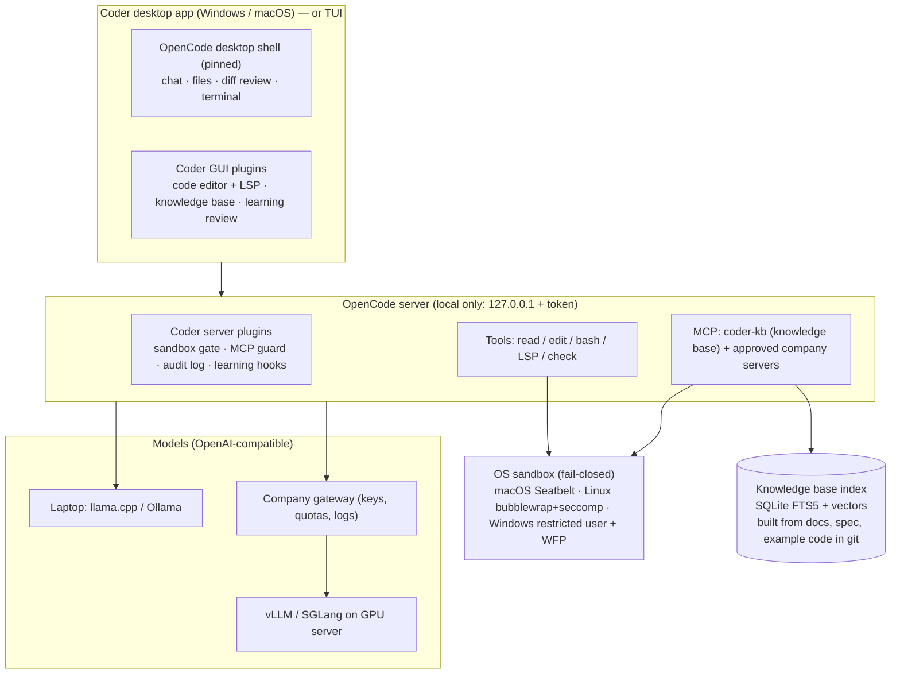

# Coder: architecture and plan

**Coder** is a secure, local-first coding agent for teams. It runs on your own models, learns your proprietary language, and improves itself only through reviewed, tested changes. It is a hardened distribution of [OpenCode v2](https://github.com/anomalyco/opencode). See [research.md](research.md) for why OpenCode was chosen.

## 1. Principles

1. **Distribution, not a deep fork.** We pin one upstream OpenCode release. Our changes live in plugins, config, MCP servers and a small, documented patch set. Upgrading means bumping the pin and re-running the evals.
2. **Local-first and fail-closed.**
   - Nothing leaves the machine except traffic to allowlisted endpoints: your model server, internal git, and the package mirror.
   - If the sandbox can't start, commands don't run.
3. **Everything lives in git:** policy, config, skills, knowledge-base sources, evals and learned improvements. That makes all of it reviewable, diffable, revertable and shareable.
4. **The model is replaceable.** Any OpenAI-compatible endpoint works, whether a laptop model or a company server. There is no vendor lock-in.
5. **The agent never edits its own guardrails.** The sandbox, policy, evals and learning pipeline are outside its write access.

## 2. Architecture



The same engine can also sit behind **VS Code / VSCodium** (OpenCode ships a VS Code extension) or **Zed** (over ACP). This matters if you'd rather not build an editor panel; see [§10](#10-decisions-needed-from-you).

## 3. Planned repository layout

```text
Coder/
├── upstream.lock              # pinned OpenCode release + checksum
├── patches/                   # small, documented patches that can't be plugins
├── config/
│   ├── managed/opencode.json  # org policy, installed where users can't edit it
│   └── providers/             # local.jsonc (laptop), company.jsonc (server)
├── plugins/
│   ├── sandbox/               # wraps bash + stdio MCP in sandbox-runtime, fail-closed
│   ├── mcp-guard/             # allowlist + tool-description hash pinning
│   ├── audit/                 # append-only log of tool calls and approvals
│   └── gui-editor/            # code editor panel for the desktop app
├── mcp/coder-kb/              # knowledge-base MCP server
├── languages/<your-lang>/     # language pack (see §5)
├── skills/                    # team skills (SKILL.md, Agent Skills format)
├── learn/                     # self-improvement pipeline (see §7)
├── evals/                     # golden tasks, hidden tests, safety canaries
└── scripts/                   # bootstrap, build installers, verify-offline
```

## 4. Models: local and company-hosted

Users switch between "This laptop" and "Company server" from the model picker. Both are plain OpenAI-compatible providers, written in OpenCode v2's provider format:

```jsonc
// Generated by `coder connect` (per person) or shared in config/models.jsonc (team, no keys).
{
  "providers": {
    "company": {
      "name": "Company models",
      "package": "@opencode/ai/providers/openai-compatible",   // built into OpenCode; no download
      "settings": { "baseURL": "https://llm.yourco.internal/v1", "apiKey": "{secret:company}" },
      "models": {
        "deepseek-v4-flash": { "limit": { "context": 131072, "output": 32768 }, "capabilities": { "tools": true, "input": ["text"] } }
      }
    },
    "local": {
      "name": "This laptop",
      "package": "@opencode/ai/providers/openai-compatible",
      "settings": { "baseURL": "http://127.0.0.1:8080/v1" },
      "models": { "qwen3.8-27b": { "limit": { "context": 65536, "output": 16384 } } }
    }
  },
  "model": "company/deepseek-v4-flash"
}
```
Other formats use `@opencode/ai/providers/openai-compatible/responses`, `…/anthropic-compatible`,
`…/google` and `…/azure/chat`; `coder connect` picks the right one.

**Model and engine picks (Nov 2026).** All licenses below were checked on Hugging Face. Benchmarks are vendor-reported.

| Where | Serving engine | Model (license) | Notes |
|---|---|---|---|
| 32 GB laptop / RTX 4090 | llama.cpp `llama-server --jinja`, or Ollama | **Qwen3.8-27B** (Apache-2.0), Devstral-Small-2-24B (Apache-2.0) | About 16–18 GB at 4-bit (estimate) |
| 96–128 GB workstation | llama.cpp | Qwen3-Coder-Next 80B-A3B | MoE, fast |
| GPU server (8×H100/H200 class) | **vLLM** or SGLang | **DeepSeek-V4-Flash** (MIT, 284B / 13B active), GLM-5.3-Flash (MIT, 320B / 18B active) | Use the engine that has a recipe for the model |
| Embeddings for the knowledge base | Same server, or local | Qwen3-Embedding-0.6B (Apache-2.0) | Runs on CPU |

**Team gateway.** Put a gateway in front of the GPU server to handle per-user keys, quotas and logging. LiteLLM proxy (MIT core) works. **Pin it by container digest**, because its PyPI package was compromised in March 2026. Alternatives are Bifrost and Envoy AI Gateway.

**Gotchas:**
- Ollama's default context window is small and it truncates silently. Set `OLLAMA_CONTEXT_LENGTH` on the server.
- llama.cpp needs `--jinja` for tool calls.
- Aggressive KV-cache quantization breaks tool calling.
- Measure the tool-call success rate for each model + engine + quantization before standardizing.

## 5. Proprietary-language support

**Evidence.** On Cangjie, a language models barely know ([ILA-agent, 2026](https://arxiv.org/html/2602.06976)), accuracy changed like this:

| Setup | Accuracy |
|---|---|
| Zero-shot | 7.7% |
| One-shot retrieval over the docs | 46.5% |
| Agent with doc-search, type-lookup and run/verify tools | **73.6%** |

Taking away doc search or run/verify each cost about 20 points. Compiler-in-the-loop fixed 98.5% of Verilog syntax errors ([RTLFixer](https://arxiv.org/abs/2311.16543)). Fine-tuning alone leaves a gap ([PyLang](https://arxiv.org/abs/2605.15607)).

So the plan is **tools and retrieval first, fine-tuning last.**

A **language pack** in `languages/<your-lang>/` contains, in order of value:

1. **An eval set first.** 100–300 tasks with hidden tests, plus a fast `check` command. Without this we can't tell whether anything helped.
2. **A `LANGUAGE.md` cheat sheet**, always in context at about 2k tokens or less. It covers:
   - a syntax summary;
   - a table of how the language differs from the one it most resembles;
   - an index of the standard library;
   - idioms and common errors;
   - 5–10 canonical examples.
3. **The compiler, linter, test runner and LSP as agent tools.** Error messages should be precise. OpenCode supports custom language servers natively:
   ```json
   { "lsp": { "yourlang": { "command": ["yourlang-lsp", "--stdio"], "extensions": [".yl"] } } }
   ```
4. **The `coder-kb` MCP server** gives the agent `search_docs`, `lookup_symbol`, `find_examples` and `get_page`.
   - **Hybrid search:** BM25 (SQLite FTS5) plus embeddings (sqlite-vec or LanceDB), merged with reciprocal-rank fusion. BM25 matters because embedding models have never seen your identifiers.
   - **Chunking:** syntax-aware, using a tree-sitter grammar for the language.
   - **Indexed sources:** spec, docs and internal repos. They are indexed **on the machine**, and the index never leaves it.
   - **Same results for everyone:** the index is rebuilt from sources pinned in git, so every colleague gets the same knowledge base.
5. **Editor support:** syntax highlighting from the same grammar, plus the same LSP.
6. **Later, once the evals exist:**
   - grammar-constrained decoding (vLLM EBNF / llama.cpp GBNF) inside a snippet-writing tool;
   - LoRA, then RL with compiler- and test-verified rewards, on a dense model of about 27B parameters;
   - training data made by translating tasks from public languages and keeping only the ones that pass your compiler and tests ([MultiPL-T](https://arxiv.org/abs/2308.09895)).

The knowledge base is an MCP server plus skills, so it also works with any other MCP-capable agent.

## 6. Security model

**Threats we design against:**
- Prompt injection from repo files, web pages and tool output. During this research, one web page we fetched contained a hidden instruction telling the agent to read the user's SSH key.
- Poisoned or "rug-pull" MCP servers.
- Supply-chain malware that **drives installed AI CLIs**:
  - s1ngularity ran agents with `--yolo` to hunt for secrets.
  - Shai-Hulud variants wrote hooks into agent and editor config files.
- Data exfiltration.
- The agent weakening its own guardrails.

**P0, before any colleague uses it:**

1. **OS sandbox for every shell command and every stdio MCP server, fail-closed.** We use [Anthropic sandbox-runtime](https://github.com/anthropic-experimental/sandbox-runtime) (Apache-2.0):

   | Platform | Mechanism | Status |
   |---|---|---|
   | macOS | Seatbelt | Mature |
   | Linux / WSL2 | bubblewrap + seccomp | Mature |
   | Windows | Dedicated user + WFP firewall filter + restricted token | **Alpha**, and needs a one-time admin install |

   If Windows proves too rough, the fallback is running the engine in WSL2 or a Dev Container.

   The sandbox allows writes only inside the workspace. It denies reads of `~/.ssh`, `~/.aws`, credential stores, browser profiles and `.env`.
2. **Network denied by default.** The allowlist is the model endpoint(s), internal git and the package mirror. Cloud-metadata and link-local addresses are blocked.
3. **Protected paths stay read-only even inside the workspace:** `.git/hooks`, `.git/config`, `opencode.json`, `.opencode/`, `AGENTS.md`, `.vscode/tasks.json` and CI files.
4. **Managed policy that users can't override.** OpenCode reads admin-owned config from:
   - Windows: `%ProgramData%\opencode`
   - macOS: `/Library/Application Support/opencode/`, or an MDM `.mobileconfig`
   - Linux: `/etc/opencode/`

   The policy sets:
   - `bash`, `edit`, `webfetch` and MCP to `ask`, and external directories to `deny`;
   - auto-approve mode off.
5. **The local server binds to localhost only and requires a token.** No remote access and no mDNS. This addresses [CVE-2026-22812](https://www.wiz.io/vulnerability-database/cve/cve-2026-22812).
6. **No phone-home:**
   - `OPENCODE_DISABLE_MODELS_FETCH`, `OPENCODE_DISABLE_AUTOUPDATE` and `OPENCODE_DISABLE_FREE_MODELS` (verified in source);
   - sharing off;
   - the updater GUI plugin removed;
   - LSP auto-download off.

   **Proven in CI** by running the test suite with all egress blocked.
7. **Untrusted repos.** Project-level config, skills and MCP servers from a freshly cloned repo need explicit trust. Otherwise the policy sets `OPENCODE_DISABLE_PROJECT_CONFIG`.

**P1:**

8. **MCP guard:**
   - an allowlist of servers pinned by package, version and hash, served from an internal mirror;
   - a pinned hash of every tool description, with a re-prompt when it changes;
   - namespaced tools;
   - a separate sandbox and minimal env for each server.
9. **Taint tracking.** Once untrusted content (web pages, issues, tool output) enters the context, network access and writes outside the workspace need approval. Web fetch is off by default. This avoids the ["lethal trifecta"](https://simonwillison.net/2025/Jun/16/the-lethal-trifecta/).
10. **Audit log** of every tool call and approval, as local JSONL with optional SIEM export.

**P2, supply chain:**
- frozen lockfiles and no install scripts;
- an internal mirror with a minimum-age delay before new versions are used;
- GitHub Actions pinned by SHA;
- signed releases (Sigstore / artifact attestations) and an SBOM (Syft);
- CI scanning of agent, skill and MCP config files.

## 7. Safe self-improvement

**What each tier may change, enforced by the sandbox and CODEOWNERS rather than by prompts:**

| Tier | What | How it changes |
|---|---|---|
| **T0 locked** | Engine, sandbox, policy, evals and graders, the learning pipeline itself, secrets | Never by the agent. Human PRs only |
| **T1 personal memory** | Small, size-capped notes about you and your projects | Agent writes automatically. Writes are scanned for injection, frozen per session, and stay on your machine |
| **T2 knowledge** | Skills, prompt fragments, playbooks, tool descriptions, the language cheat sheet | Agent **proposes**, evals gate, a human approves the PR |
| **T3 code** | Plugins and tools | Agent drafts on a branch inside the sandbox. A human reviews. Loading is transactional and reverts automatically on failure |

**The learning loop:**

1. **Reflect.** After a session, or nightly, a reflector writes small **delta** patches: `{target, diff, rationale, evidence: [session ids]}`. It never rewrites whole files.
2. **Static gates.** Check the schema and size limits. Reject any patch that deletes more than X% of a file. Scan for secrets and injection. Reject anything touching protected paths.
3. **Probe (Harness²-style).**
   - Re-run the tasks the change claims to improve, baseline against candidate, over several seeds.
   - Run the full regression suite with **hidden tests** and **integrity canaries**:
     - impossible tasks where the right answer is to stop;
     - test-file hash checks;
     - planted prompt injections;
     - destructive-command bait.
   - Graders run **outside** the agent's sandbox.
   - The change must improve the target and must not regress any must-pass case.
4. **Review.** A PR opens automatically with the diff, a before/after table and links to traces. A CODEOWNER approves it.
5. **Ship and watch.**
   - `learned.lock` pins content hashes.
   - Each change carries helped/hurt counters, and it reverts automatically past a threshold.
   - Every change is recorded in a ledger and can be undone with `coder learn rollback <id>`.
6. **Curate.** Unused skills move from active to stale (14 days) to archived (30 days). They are never deleted automatically, and they can be pinned.

**Sharing what was learned:**
- **Personal** (`~/.coder/`): never shared.
- **Project** (`.agents/skills/` in each repo): promoted from personal by PR.
- **Org** (a team-skills repo, consumed by signed tag): promoted from project by PR.

Each promotion step generalizes the skill, strips personal data, and runs the same eval CI.

## 8. Sharing with colleagues

- **Developers:**
  1. `git clone` this repo.
  2. Run `scripts/bootstrap`. It fetches the pinned OpenCode and checks its checksum, builds the plugins, installs config, and builds the knowledge-base index.
  3. Run `coder` (terminal) or `coder desktop`.
- **Everyone:** signed installers built in CI from this repo, as `.exe`/`.msi` for Windows and `.dmg` for macOS. IT deploys the managed policy through Intune/GPO on Windows or MDM on macOS.
- **Config layers, highest priority first, following OpenCode's precedence order:**
  1. org managed policy (locked);
  2. per-project `opencode.json`;
  3. Coder defaults from this repo, loaded through `OPENCODE_CONFIG`;
  4. personal settings in `~/.config/opencode`.
- **Connecting to models.** Choose "This laptop" or "Company server". API keys come from the environment or the OS keychain, never from files in git.
- **Same version everywhere.** The engine, plugins, skills and knowledge-base sources are all pinned.

## 9. Status (November 2026)

**Your decisions:**
- Platforms: macOS, Windows and Linux, plus remote Linux servers.
- Editor: both an editor inside the desktop app and a VS Code extension.
- Docs: imported through chat into markdown files.
- Models: support every common model server and API format.
- Setup: colleagues clone the repo and run it.
- Shared skills: added through manual PRs.

| Area | State |
|---|---|
| Clone-and-run launchers (macOS/Linux/Windows), pinned and verified downloads | **Done** |
| `coder connect` for any model server and API format, with a tool-calling check; team model file plus per-person keys | **Done** |
| Hardened config: no phone-home, isolated config and database, untrusted project config off, policy layered last | **Done** |
| Guardrails plugin: fail-closed sandbox for shell and local MCP, hard denies, scanned knowledge/memory, MCP pinning, audit log | **Done** |
| Knowledge base: chat import through the `knowledge` skill, `INDEX.md` always loaded, personal `MEMORY.md` | **Done** |
| Desktop app (pinned official build, updater blocked) with Coder's code editor panel | **Done** |
| VS Code extension (local and Remote-SSH) | **Done** |
| Remote Linux: `coder remote` over SSH, desktop "Add server → SSH" through a Coder shim, `coder serve` on loopback | **Done** |
| CI on all three OSes, including an end-to-end run of the real OpenCode against a mock model server | **Done**: passing on Windows, macOS and Linux |
| Resource budgets in CI (context ~5.7k tokens, ~390 MB RAM, ~1–2 s), lean launcher (exec hand-off) | **Done** |
| Import skills, MCP servers (Claude/Cursor/VS Code/OpenCode formats), plugins; tool scaffold | **Done** |
| `coder eval` benchmark: hidden tests, integrity canaries, run history and regression flags | **Done** (starter tasks; add your language's tasks) |

**Changes from the original plan:**
- **No LSP integration.** OpenCode v2 parses `lsp` config but has no language-server runtime, so
  the "compiler in the loop" is the compiler or linter run as an approved shell command (see the guide).
- **No native sandbox on Windows yet.** sandbox-runtime's Windows support is alpha, so Windows
  defaults to approve-every-command, and WSL2 gets the full sandbox.
- **No knowledge search server.** You chose chat import into markdown, so knowledge is plain files
  plus the agent's own search tools, and no `coder-kb` MCP server is needed.
- **Team skills arrive by PR**, as you asked. Personal memory is automatic, but bounded and scanned.

## 10. Next steps

1. **Benchmark your models:** run `coder eval` against each candidate model and quantization, then
   commit the baselines.
2. **Your language:** paste its docs into a session ("learn these docs"), review the generated
   `knowledge/` files, and add its build and check commands to the cheat sheet.
3. **Desktop app from source:** a CI workflow that builds the OpenCode desktop app with the updater
   removed and publishes it to this repo's releases, replacing the official build.
4. **Windows sandbox:** adopt sandbox-runtime's Windows mode once it leaves alpha (needs a one-time
   admin install per machine).
5. **Safe self-improvement:** a `learn` loop where the agent proposes skill and knowledge changes
   as PRs, gated by an eval set in your language. See §7.
6. **Evals for your language:** grow `evals/tasks` toward 100–300 tasks with hidden tests. This
   lets you measure which model, prompt or knowledge changes actually help.
